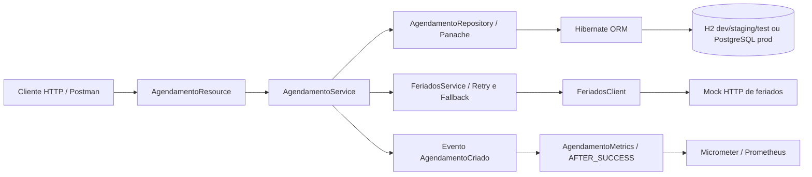

# Arquitetura técnica — Agendamento de Massagem

[README](README.md) · [Checklist de requisitos](checklist.md) · [Especificação do professor](trabalho-final-especificacao-professor.md)

## Contexto e organização

A aplicação reserva salas por data e período inteiro, impede sobreposição da mesma sala e consulta feriados por UF. É uma API sem frontend, autenticação ou cadastros de salas e usuários. O único módulo Maven é [agendamento-api](agendamento-api/pom.xml); o mock Java é um processo HTTP separado, sem módulo Maven próprio.

A organização é **Package by Feature + Boundary / Domain / Repository**. Há uma funcionalidade, `studio.agendamento.agendamentos`, integração em `studio.agendamento.integracao.feriados` e componentes transversais em `studio.agendamento.platform`.

O enum de período reside no pacote `repository` e também é usado pelo BO e DTO de entrada.

## Componentes e modelos

| Componente | Responsabilidade implementada |
|---|---|
| [AgendamentoResource](agendamento-api/src/main/java/studio/agendamento/agendamentos/boundary/AgendamentoResource.java) | Define as cinco operações CRUD, valida entradas, passa campos ao serviço, converte BO para DTO, monta status e `Location` |
| [AgendamentoRequestDto](agendamento-api/src/main/java/studio/agendamento/agendamentos/boundary/AgendamentoRequestDto.java) | Record de entrada com restrições Bean Validation; não é entidade |
| [AgendamentoResponseDto](agendamento-api/src/main/java/studio/agendamento/agendamentos/boundary/AgendamentoResponseDto.java) | Record de saída; `from` converte data/enum para strings e define `salaDisponivel=false` |
| [AgendamentoBo](agendamento-api/src/main/java/studio/agendamento/agendamentos/domain/AgendamentoBo.java) | Record de dados do negócio retornado pelo serviço, separado de HTTP e JPA |
| [AgendamentoService](agendamento-api/src/main/java/studio/agendamento/agendamentos/domain/AgendamentoService.java) | Regras, transações, mapeamento Entity → BO e emissão de evento de criação |
| [AgendamentoRepository](agendamento-api/src/main/java/studio/agendamento/agendamentos/repository/AgendamentoRepository.java) | `PanacheRepository<AgendamentoEntity>` e consulta de conflito por sala/data/período |
| [AgendamentoEntity](agendamento-api/src/main/java/studio/agendamento/agendamentos/repository/AgendamentoEntity.java) | Mapeamento da tabela `agendamentos`; ID gerado e constraint única |
| [FeriadoResponse](agendamento-api/src/main/java/studio/agendamento/integracao/feriados/FeriadoResponse.java) | Contrato externo: UF, data, indicador Boolean de feriado e descrição |

O serviço não recebe DTOs HTTP: `criar` e `atualizar` recebem valores individuais e retornam BO. Há mapeamento manual, sem biblioteca de conversão. [OrganizacaoPacotesTest](agendamento-api/src/test/java/studio/agendamento/architecture/OrganizacaoPacotesTest.java) verifica pacotes, separação de entidade/BO/DTO e assinaturas do serviço; não é uma verificação completa de todas as dependências arquiteturais.

### CDI e Lombok

`AgendamentoService`, `AgendamentoRepository`, `FeriadosService`, health checks e métricas usam `@ApplicationScoped`. `AgendamentoResource` e `AgendamentoService` usam `@RequiredArgsConstructor`: Lombok gera o construtor com os campos finais, permitindo injeção por construtor pelo Quarkus. A entidade JPA tem campos públicos e não usa `@Data`.

`FeriadosService` declara explicitamente o construtor com `@RestClient`. `AgendamentoMetrics` recebe `MeterRegistry`; o serviço de negócio recebe `Event<AgendamentoCriado>`. `/info` e readiness recebem valores por `@ConfigProperty`.

## Fluxo das requisições

1. O Resource recebe JSON; Jackson desserializa e Bean Validation verifica corpo e parâmetros.
2. GET de coleção usa `listAll(Sort.by("id"))`; GET individual usa `findById` e lança exceção de ausência quando necessário.
3. POST abre transação, consulta conflito e, se não houver, consulta feriados. PUT primeiro carrega a reserva, depois verifica conflito ignorando seu ID e consulta feriados.
4. Após aprovação, POST preenche uma entidade e chama `persistAndFlush`. PUT altera a entidade gerenciada e chama `flush`, persistindo por dirty checking.
5. A escrita converte violações SQL de unicidade reconhecidas para exceção de negócio. POST emite `AgendamentoCriado` dentro da transação.
6. O serviço retorna um BO; o Resource converte para o DTO HTTP. A criação retorna 201 com `Location`, a atualização retorna 200.
7. O observador transacional incrementa o contador somente após commit bem-sucedido.

DELETE usa `deleteById` em transação; retorna 404 se não removeu registro, ou 204 pelo Resource. GET/DELETE não consultam feriados. Os mappers centralizam as respostas de erro, evitando try/catch em cada endpoint.

## Persistência e consistência

A [entidade](agendamento-api/src/main/java/studio/agendamento/agendamentos/repository/AgendamentoEntity.java) tem ID `Long` com `GenerationType.IDENTITY`; `id_sala`, `uf`, `data` e `periodo` não nulos; `id_usuario` anulável. A UF possui comprimento 2; período usa `EnumType.STRING`, comprimento 16; data é `LocalDate`. Não há relacionamentos JPA ou chaves estrangeiras para salas/usuários.

A chave única `uk_agendamento_sala_data_periodo` cobre `id_sala`, `data`, `periodo`, sem UF. A consulta prévia melhora a resposta ao usuário, mas não elimina a corrida entre requisições; a constraint protege a persistência. `traduzirConflito` percorre as causas da `PersistenceException` procurando SQLState `23505`. Qualquer erro com esse estado é traduzido para `ReservaConflitanteException`; outros erros de persistência são propagados, sem mapper genérico próprio.

`criar`, `atualizar` e `excluir` usam `@Transactional`. A chamada HTTP externa ocorre dentro da transação nas criações/atualizações; indisponibilidade aumenta seu tempo de duração. Não há `@Version`, bloqueio explícito ou prevenção de perda de atualização entre duas edições concorrentes do mesmo registro. O teste de concorrência existente cobre duas criações do mesmo intervalo em H2.

Os profiles efetivos, em [application.properties](agendamento-api/src/main/resources/application.properties), são:

| Profile | Datasource e schema |
|---|---|
| `dev` | H2 em `jdbc:h2:file:./data/agendamentos`, usuário `sa`, senha vazia; `update`; sem script de carga |
| `staging` | Herda H2 em arquivo e `update`; [arquivo adicional](agendamento-api/src/main/resources/application-staging.properties) muda o nome |
| `prod` | PostgreSQL via `DB_URL`, `DB_USERNAME`, `DB_PASSWORD`; `update`; sem script de carga |
| `test` | H2 em memória `agendamento-test`; `drop-and-create`; referencia `import.sql`, ausente no repositório |

O pool tem mínimo 1 e máximo 5 conexões. O caminho H2 é relativo ao diretório de execução. O teste de staging usa outro H2 em memória e schema descartável por sobrescritas explícitas, preservando dados locais.

No Compose, [01-schema.sql](agendamento-api/database/init/01-schema.sql) cria a tabela na inicialização de um volume PostgreSQL novo. Ele define `periodo VARCHAR(20)` e `CHECK (data >= CURRENT_DATE)`, diferentemente do mapeamento JPA, e não declara a constraint única. O Hibernate está configurado com `update`, mas o estado final dessas diferenças deve ser inspecionado em PostgreSQL; não há migrações versionadas. O CHECK do SQL também pode afetar uma atualização de registro cuja data já passou; essa restrição não existe no schema H2 criado somente pelo ORM.

## Integração HTTP e resiliência

[FeriadosClient](agendamento-api/src/main/java/studio/agendamento/integracao/feriados/FeriadosClient.java) usa `@RegisterRestClient(configKey="feriados")`, `@GET`, `@Path("/feriados")`, query params `uf` e `data` e JSON de resposta. A URL é externalizada por `FERIADOS_URL`; connect/read timeout são de 1.000 ms cada.

[FeriadosService](agendamento-api/src/main/java/studio/agendamento/integracao/feriados/FeriadosService.java) confere resposta não nula, indicador `feriado` não nulo, UF e data iguais à consulta. Não valida nem utiliza a descrição. Respostas incompatíveis também disparam falha.

`@Retry(maxRetries=2, delay=100, jitter=0)` permite uma tentativa inicial e duas repetições. `@Fallback(fallbackMethod="indisponivel")` lança `FeriadosIndisponiveisException`, mapeada para 503. O fallback não autoriza agendamentos sem verificar feriados. Não há cache ou circuit breaker implementado.

O [mock de execução local](agendamento-api/feriados-local/src/FeriadosLocalServer.java) usa `HttpServer` do JDK. Considera feriado 1º de janeiro e pares UF:data de `FERIADOS_EXTRAS`. UF inválida ou data inválida gera 400 com contrato próprio do mock; método/caminho incompatível dentro de seu contexto gera 405. O [health check do contêiner](agendamento-api/feriados-local/src/FeriadosHealthCheck.java) consulta `/feriados` e exige HTTP 200.

O [mock de testes](agendamento-api/src/test/java/studio/agendamento/agendamentos/boundary/FeriadosTestResource.java) é outro servidor, em porta aleatória. Possui modos normal, falha HTTP 503, resposta incompleta e barreira de concorrência, com `/controle` e `/chamadas` apenas para testes. Esses endpoints não existem no mock local de demonstração nem na API.

## Validação e erros

[AgendamentoRequestDto](agendamento-api/src/main/java/studio/agendamento/agendamentos/boundary/AgendamentoRequestDto.java) combina `@NotNull`, `@Positive`, `@NotBlank`, `@Pattern` e `@FutureOrPresent`. O Resource aplica `@NotNull @Valid` no corpo e `@Positive` nos IDs de caminho. Usuário é opcional porque `@Positive` permite null; sala, data e período não são opcionais. Essas validações estão na fronteira HTTP, não repetidas no serviço para chamadas internas.

[ErroResponse](agendamento-api/src/main/java/studio/agendamento/platform/error/ErroResponse.java) contém `codigo`, `mensagem`, `timestamp` gerado com `Instant.now()`, `path` vindo de `UriInfo.getPath()` e lista imutável de `detalhes` (`campo`, `mensagem`). [ErroHttp](agendamento-api/src/main/java/studio/agendamento/platform/error/ErroHttp.java) monta a resposta JSON.

| Mapper em [platform/error/mapper](agendamento-api/src/main/java/studio/agendamento/platform/error/mapper) | Exceção / resposta |
|---|---|
| `ValidacaoExceptionMapper` | `ResteasyReactiveViolationException` → 400 `DADOS_INVALIDOS`; detalhes ordenados por campo/mensagem, mantendo só o último segmento do caminho |
| `FormatoJsonInvalidoMapper` | `MismatchedInputException` → 400 `DADOS_INVALIDOS` |
| `RequisicaoInvalidaMapper` | `WebApplicationException` → status original; código `DADOS_INVALIDOS` para 400 ou `HTTP_<status>` nos demais |
| `AgendamentoNaoEncontradoMapper` | `AgendamentoNaoEncontradoException` → 404 `AGENDAMENTO_NAO_ENCONTRADO` |
| `ReservaConflitanteMapper` | `ReservaConflitanteException` → 409 `RESERVA_CONFLITANTE` |
| `DiaFeriadoMapper` | `DiaFeriadoException` → 409 `DIA_FERIADO` |
| `FeriadosIndisponiveisMapper` | `FeriadosIndisponiveisException` → 503 `FERIADOS_INDISPONIVEIS` |

Todos são `@Provider`. Os mappers de validação e formato JSON têm prioridade `Priorities.USER - 1`; não existe atualmente mapper de catálogo com o qual justificar conflito. A padronização comprovável se limita às exceções cobertas: não há mapper universal para qualquer falha inesperada.

## Configuração e observabilidade

[AgendamentoInfoResource](agendamento-api/src/main/java/studio/agendamento/platform/info/AgendamentoInfoResource.java) expõe o nome via `@ConfigProperty(name="agendamento.nome")`. A tabela de variáveis e os comandos para PowerShell e Bash, incluindo alternância de profiles, estão no [README](README.md#configuracoes-e-profiles). Comentários antigos sobre H2 em prod ou catálogo não prevalecem sobre as propriedades `%prod` e classes atuais.

[AgendamentoLivenessCheck](agendamento-api/src/main/java/studio/agendamento/platform/health/AgendamentoLivenessCheck.java) sempre retorna UP quando invocado. Não possui condição interna DOWN. Falha ou bloqueio do processo impede a resposta da probe; não implica resposta JSON DOWN.

[AgendamentoReadinessCheck](agendamento-api/src/main/java/studio/agendamento/platform/health/AgendamentoReadinessCheck.java) publica `agendamento-habilitado`, controlado por `agendamento.pronto`/`AGENDAMENTO_PRONTO`. A extensão de datasource também contribui com sua verificação de saúde à readiness. O check customizado não consulta o banco diretamente, nem a integração de feriados. Uma configuração `false` sinaliza indisponibilidade operacional, mas não bloqueia chamadas diretas às rotas CRUD.

[AgendamentoMetrics](agendamento-api/src/main/java/studio/agendamento/platform/metrics/AgendamentoMetrics.java), inicializado com `@Startup`, registra `agendamentos.criados`. O observador de [AgendamentoCriado](agendamento-api/src/main/java/studio/agendamento/agendamentos/domain/AgendamentoCriado.java) usa `TransactionPhase.AFTER_SUCCESS`. A exposição Prometheus é `agendamentos_criados_total`. PUT, DELETE e rollback não incrementam o contador; ele registra criações confirmadas durante a vida do processo, não a quantidade atual de reservas nem um histórico persistente.

## Validação manual HTTP

Os scripts [PowerShell](agendamento-api/scripts/validar-http.ps1) e [Bash](agendamento-api/scripts/validar-http.sh) exercitam o mesmo roteiro HTTP, incluindo CRUD, erros e contador Prometheus. As dependências, formas de execução e opções de falha externa estão no [README](README.md#postman-e-script-automatizado). Os scripts operam sobre a API iniciada separadamente e tentam excluir a reserva temporária ao terminar.
